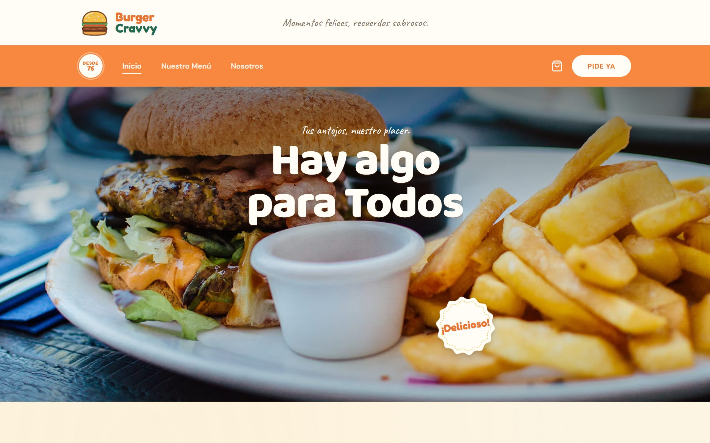
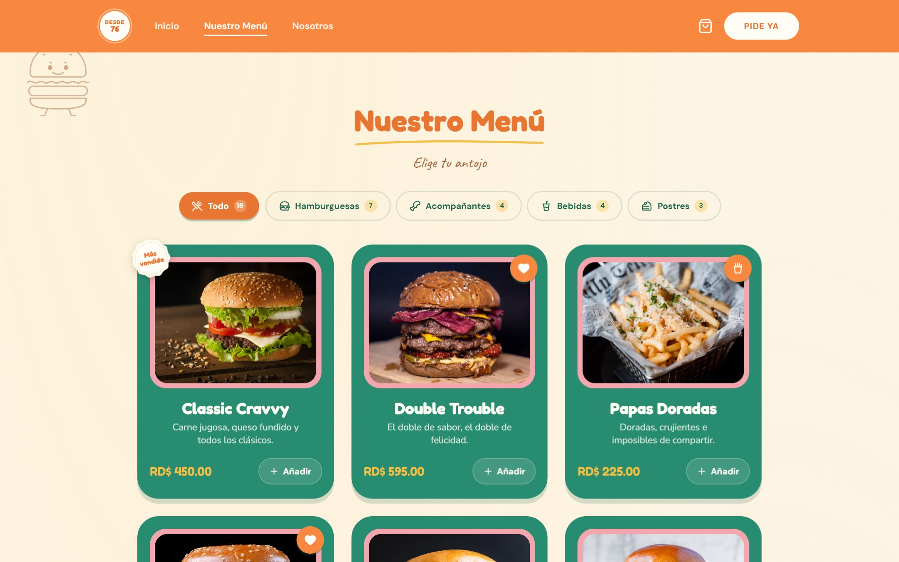
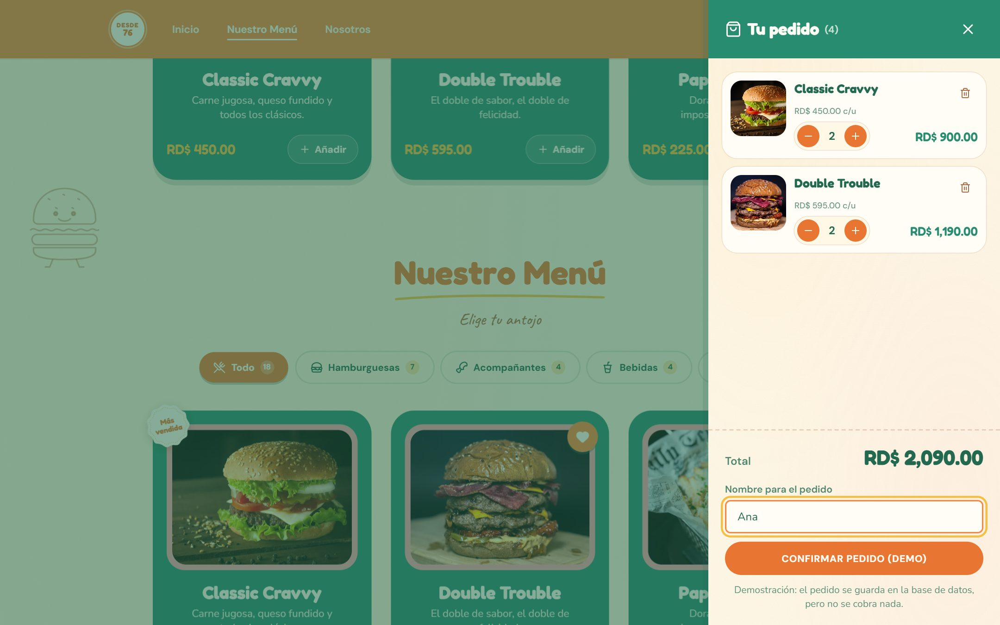
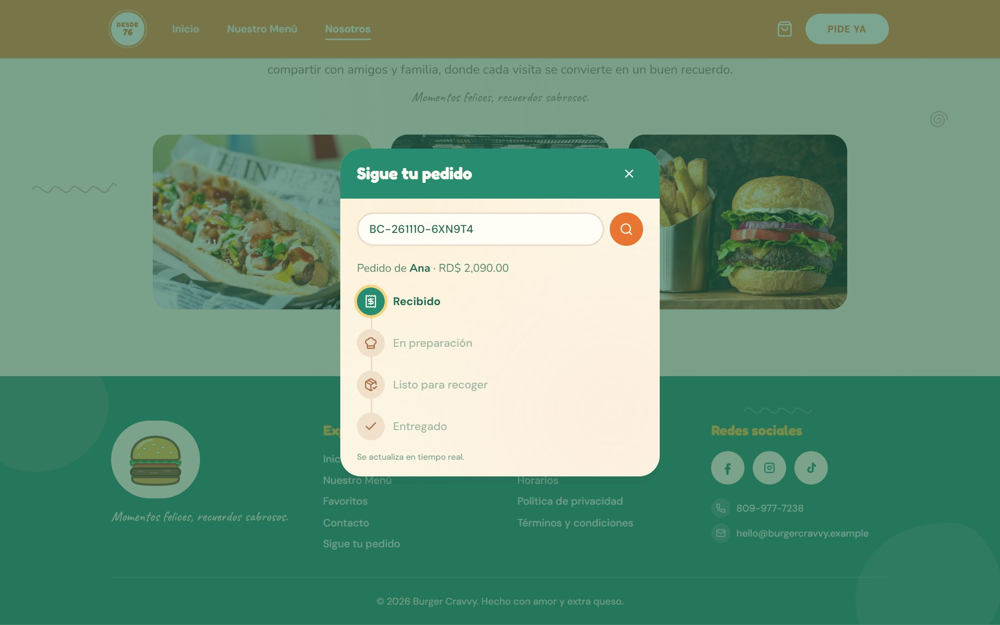
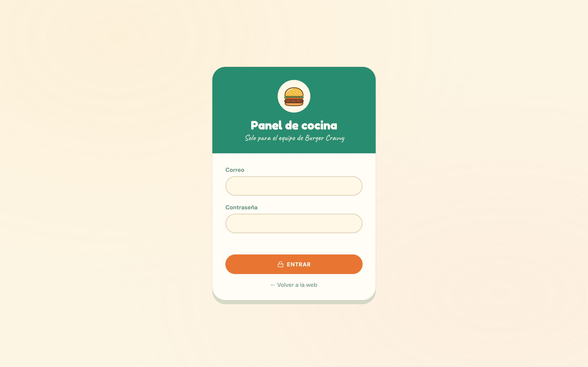
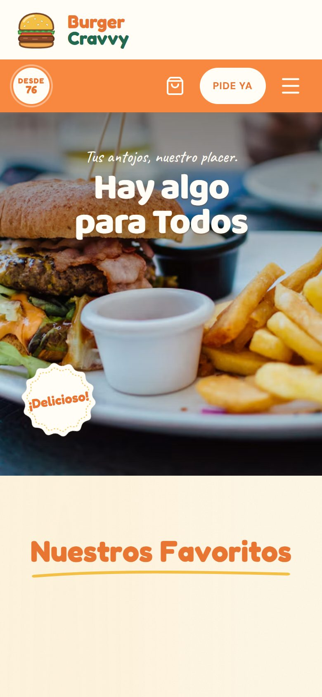
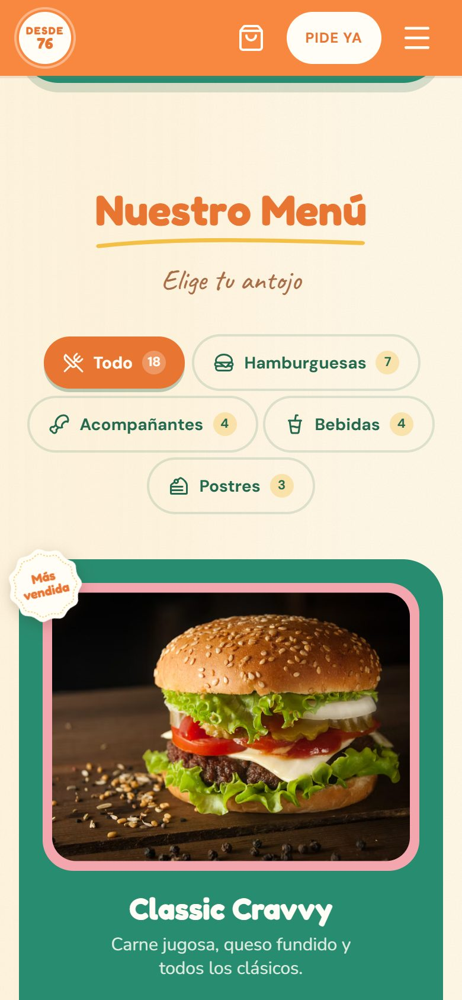
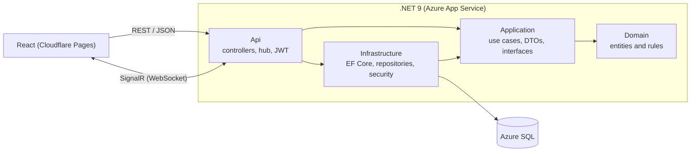

# Burger Cravvy 🍔

[Español](README.md) · **English**

[](https://github.com/Angelismejia/burger-cravvy-fullstack/actions/workflows/ci.yml)


A **fictional** retro burger joint with online ordering and a **real-time kitchen dashboard**.
React frontend + .NET API built with Clean Architecture, SQL Server and SignalR, deployed to the cloud.

> The app's UI is in Spanish (the target market is the Dominican Republic, prices in RD$).

### 🔗 Live demo

| | |
|---|---|
| 🌐 **Website** | **https://burger-cravvy-fullstack.pages.dev** |
| 👩‍🍳 **Kitchen dashboard** | https://burger-cravvy-fullstack.pages.dev/panel |
| 📘 **API (Swagger)** | https://burgercravvy-api-ftexgydxftcteyhc.westus3-01.azurewebsites.net/swagger |

> The API runs on Azure's free tier: after a while without traffic, **the first request can take about 20 s**
> while the server and the database wake up. Meanwhile the website shows the menu from a local copy.
> Orders are for demo purposes: they are saved, but nothing is charged.



---

## ✨ Features

- **Menu by category** (burgers, sides, drinks and desserts) loaded from the API.
- **Cart** persisted in the browser and **guest checkout**: only a name is required.
- **Real-time order tracking**: customers watch their order move from *Received* to *Preparing*, *Ready* and *Delivered* without reloading.
- **Kitchen dashboard** with login: new orders show up instantly with a sound alert.
- **Role-based menu management**: an **Employee** can mark items as sold out; an **Admin** can also change prices and create, edit and retire products.
- When a price changes or an item sells out, **every open browser updates on its own**.

## 📸 Screenshots

| Menu with category tabs | Cart |
|---|---|
|  |  |
| **Order tracking (real time)** | **Kitchen dashboard login** |
|  |  |

<p align="center">
  
  &nbsp;&nbsp;
  
</p>

## 🧱 Tech stack

| Layer | Technologies |
|---|---|
| **Backend** | ASP.NET Core 9 Web API, EF Core, SQL Server, SignalR, JWT, Rate Limiting, ProblemDetails, Swagger |
| **Frontend** | React 19, TypeScript, Vite, Tailwind CSS 4, Motion, SignalR client |
| **Testing** | xUnit (82 domain and use-case tests) · Vitest (13 tests for cart and order logic) |
| **CI/CD** | GitHub Actions (build and tests on every push) · Azure App Service + Azure SQL · Cloudflare Pages |

## 🏛️ Architecture



**Clean Architecture**: `Domain` has no dependencies. Business rules live in the entities, not in the controllers.
For example, an order can only move through valid states:

```
Pending ──► Preparing ──► Ready ──► Delivered
   └────────────┴──► Cancelled
```

The frontend follows the same idea: `domain/` (pure, tested logic), `application/` (state and use cases),
`infrastructure/` (HTTP, SignalR, storage) and `presentation/` (components).

<details>
<summary><b>Folder structure</b></summary>

```
src/
├── BurgerCravvy.Domain/          Entities (Product, Order, OrderItem, Employee), enums and business rules
├── BurgerCravvy.Application/     Use cases, DTOs and repository interfaces
├── BurgerCravvy.Infrastructure/  EF Core + SQL Server: DbContext, configurations, migrations, repositories, JWT
├── BurgerCravvy.Api/             Controllers, SignalR hub, authentication, rate limiting, Swagger
└── BurgerCravvy.Web/             React + TypeScript (domain / application / infrastructure / presentation)
tests/
├── BurgerCravvy.Domain.Tests/       Business rules (order states, prices, codes…)
└── BurgerCravvy.Application.Tests/  Use cases with in-memory repositories (no database)
```
</details>

## 🔐 Security decisions

- **Prices always come from the database**: the client only sends products and quantities.
- **Passwords hashed with salted PBKDF2** (the ASP.NET Core Identity hasher).
- **Role-based JWT** (`Empleado`, `Admin`). The key is validated at startup (32+ characters) and is never in the repo.
- **Per-IP rate limiting**: 5 login attempts and 10 orders per minute (returns `429`).
- **Login does not reveal which accounts exist**: same message for a wrong email or a wrong password.
- **Hard-to-guess order codes** (`BC-261110-6XN9T4`) generated with a cryptographically secure RNG.
- **ProblemDetails error responses** without internal details. The dashboard session lives in `sessionStorage`.

## 🔌 Endpoints

| Method | Route | Description |
|---|---|---|
| GET | `/api/productos?favoritos=true` | Menu (or favorites only) |
| GET | `/api/productos/{slug}` | A single product |
| POST | `/api/pedidos` | Places a **pending** order (demo, no payments) |
| GET | `/api/pedidos/{codigo}` | Order tracking |
| POST | `/api/auth/login` | Employee login → JWT |
| GET | `/api/panel/pedidos` | 🔒 Kitchen queue |
| PATCH | `/api/panel/pedidos/{codigo}/estado` | 🔒 `{ "action": "preparar" \| "listo" \| "entregar" \| "cancelar" }` |
| GET | `/api/panel/productos` | 🔒 Full menu, including retired items |
| PATCH | `/api/panel/productos/{slug}/disponibilidad` | 🔒 Mark as sold out or available |
| POST | `/api/panel/productos` | 👑 Create product |
| PUT | `/api/panel/productos/{slug}` | 👑 Edit product |
| POST | `/api/panel/productos/{slug}/retirar` | 👑 Retire from the menu (soft delete) |
| POST | `/api/panel/productos/{slug}/reactivar` | 👑 Put back on the menu |

🔒 = `Empleado` or `Admin` role · 👑 = `Admin` only · Header `Authorization: Bearer <token>` (in Swagger, use **Authorize**).

### Real time (SignalR, `/hubs/pedidos`)

| Event | Received by | Purpose |
|---|---|---|
| `OrderCreated` | `cocina` group (employee JWT) | The order shows up on the dashboard with a sound alert |
| `OrderUpdated` | `cocina` + the order's group | The customer's timeline advances on its own |
| `ProductUpdated` | everyone | Price and "Sold out" change without reloading |

If the connection drops, the website reconnects automatically and polls every 30 s in the meantime.

## 🚀 Run locally

**Requirements:** .NET 9 SDK, SQL Server (defaults to `.\SQLEXPRESS` with Windows authentication) and Node.js 20.19+ or 22.12+.

```bash
# 1) Configuration: copy the template and set your JWT key (32+ characters) and test users
cp src/BurgerCravvy.Api/appsettings.Development.example.json src/BurgerCravvy.Api/appsettings.Development.json

# 2) API → http://localhost:5256/swagger  (applies migrations and creates the database)
dotnet run --project src/BurgerCravvy.Api --launch-profile http

# 3) Website → http://localhost:5175
cd src/BurgerCravvy.Web
npm install
npm run dev -- --port 5175
```

- Different database: change `ConnectionStrings:BurgerCravvy` in `src/BurgerCravvy.Api/appsettings.json`.
- Different API URL for the website: create `src/BurgerCravvy.Web/.env` with `VITE_API_URL=https://your-api`.
- Dashboard at **http://localhost:5175/panel** with the `SeedEmployee` and `SeedAdmin` users from `appsettings.Development.json`.

## 🧪 Tests

```bash
dotnet test                              # Domain + Application (xUnit)
cd src/BurgerCravvy.Web && npm test      # cart and orders (Vitest)
```

GitHub Actions builds the solution and runs every test on each push and pull request ([ci.yml](.github/workflows/ci.yml)).

<details>
<summary><b>Migrations</b></summary>

```bash
dotnet ef migrations add MigrationName -p src/BurgerCravvy.Infrastructure -s src/BurgerCravvy.Api -o Persistence/Migrations
```
</details>

## 🗺️ Roadmap

- [ ] `docker-compose` to start SQL Server, the API and the website with a single command.
- [ ] API integration tests (`WebApplicationFactory` against a real database).
- [x] Optimistic concurrency on orders (`RowVersion`): if two employees update the same order at once, the second one gets `409 Conflict`.
- [ ] A `/health` endpoint for Azure monitoring.

## 📄 License

[MIT](LICENSE). Photos from [Unsplash](https://unsplash.com); Burger Cravvy is a fictional business.
