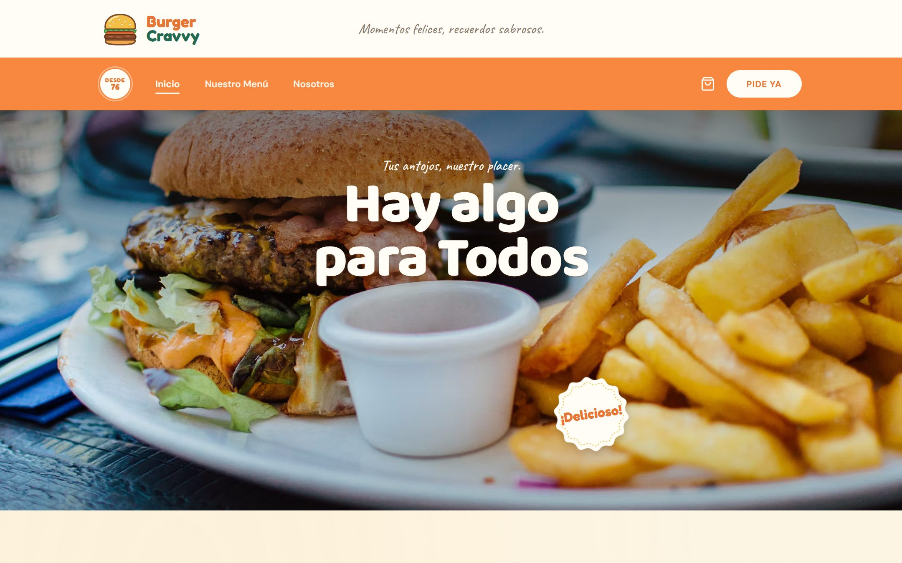
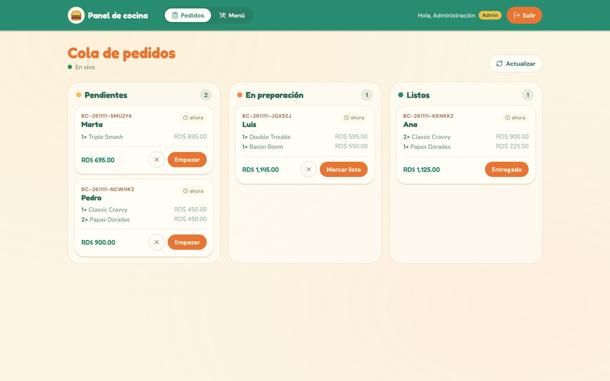
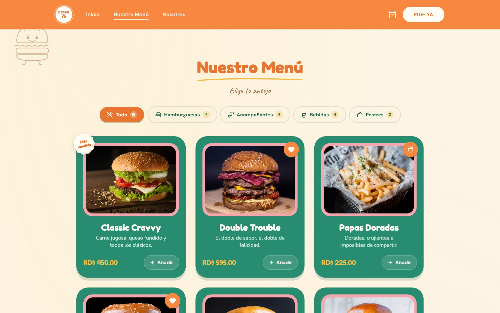
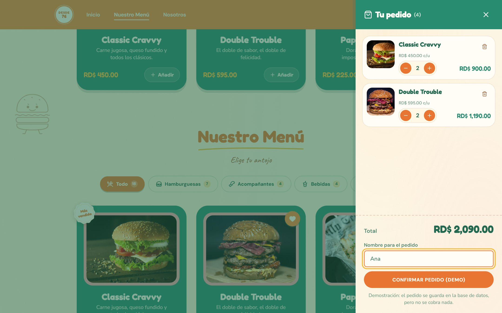
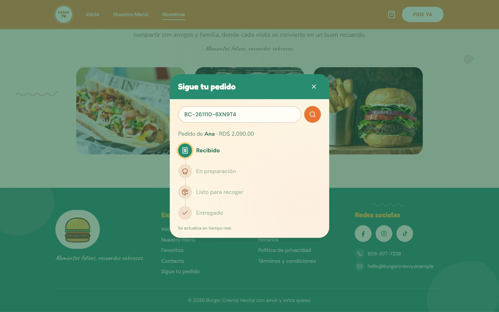
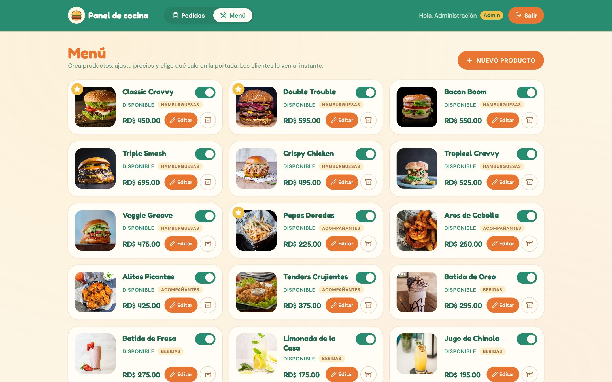
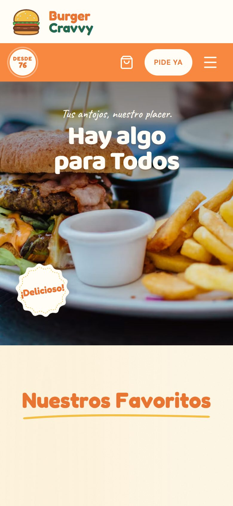
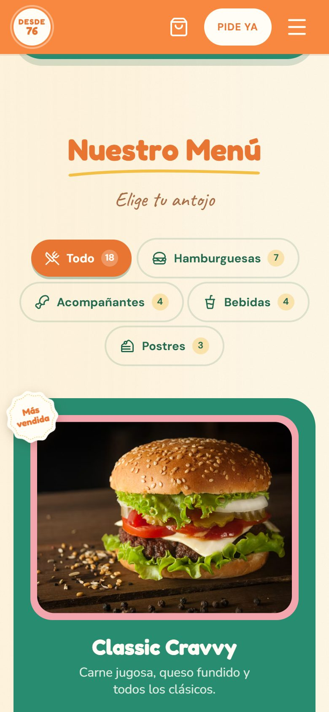
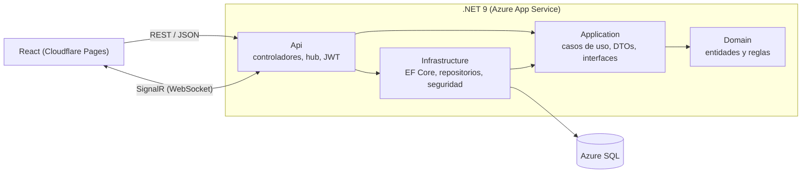

# Burger Cravvy 🍔

**Español** · [English](README.en.md)

[](https://github.com/Angelismejia/burger-cravvy-fullstack/actions/workflows/ci.yml)


Hamburguesería retro **ficticia** con pedidos en línea y un **panel de cocina en tiempo real**.
Web en React + API en .NET con Clean Architecture, SQL Server y SignalR, desplegada en la nube.

### 🔗 Demo en vivo

| | |
|---|---|
| 🌐 **Web** | **https://burger-cravvy-fullstack.pages.dev** |
| 👩‍🍳 **Panel de cocina** | https://burger-cravvy-fullstack.pages.dev/panel |
| 📘 **API (Swagger)** | https://burgercravvy-api-ftexgydxftcteyhc.westus3-01.azurewebsites.net/swagger |
| 🔑 **Usuario demo del panel** (rol Empleado) | `demo@burgercravvy.test` · `Cocina-Demo-2026` |

**Prueba el tiempo real:** abre el panel con el usuario demo en una pestaña, haz un pedido desde la web en otra
y mira cómo aparece en la cocina al instante (con sonido). Al moverlo en el panel, el seguimiento del cliente avanza solo.

> La API está en el plan gratuito de Azure: si lleva un rato sin uso, **la primera carga puede tardar unos 20 s**
> mientras despiertan el servidor y la base de datos. Mientras tanto la web muestra el menú con una copia local.
> Los pedidos son de demostración: se guardan, pero no se cobra nada.



---

## ✨ Qué hace

- **Menú por categorías** (hamburguesas, acompañantes, bebidas y postres) cargado desde la API.
- **Carrito** que se guarda en el navegador y **pedido sin registro**: solo pide un nombre.
- **Seguimiento en tiempo real**: el cliente ve cómo su pedido pasa de *Recibido* a *En preparación*, *Listo* y *Entregado* sin recargar.
- **Panel de cocina** con login: los pedidos nuevos aparecen al instante con un aviso sonoro.
- **Gestión del menú por roles**: el **Empleado** marca productos agotados; el **Admin** además cambia precios, crea, edita y retira productos.
- Si un precio cambia o un producto se agota, **todas las webs abiertas se actualizan solas**.

## 📸 Capturas

**Panel de cocina:** la cola de pedidos se actualiza en vivo por SignalR.



| Menú con pestañas | Carrito |
|---|---|
|  |  |
| **Seguimiento del pedido (tiempo real)** | **Gestión del menú (Admin)** |
|  |  |

<p align="center">
  
  &nbsp;&nbsp;
  
</p>

## 🧱 Tecnologías

| Capa | Tecnologías |
|---|---|
| **Backend** | ASP.NET Core 9 Web API, EF Core, SQL Server, SignalR, JWT, Rate Limiting, ProblemDetails, Swagger |
| **Frontend** | React 19, TypeScript, Vite, Tailwind CSS 4, Motion, cliente de SignalR |
| **Tests** | xUnit: 82 unitarios (dominio y casos de uso) + 8 de integración contra SQL Server real · Vitest: 13 (carrito y pedidos) |
| **CI/CD** | GitHub Actions: build y tests en cada push y, si todo pasa, deploy de la API a Azure App Service + Azure SQL · Cloudflare Pages para la web |
| **Local** | Docker Compose (SQL Server + API + web con un comando) |

## 🏛️ Arquitectura



**Clean Architecture**: el `Domain` no depende de nada. Las reglas del negocio viven en las entidades, no en los controladores.
Por ejemplo, un pedido solo puede avanzar por estados válidos:

```
Pendiente ──► En preparación ──► Listo ──► Entregado
    └──────────────┴──► Cancelado
```

La web repite la misma idea en el frontend: `domain/` (lógica pura y probada), `application/` (estado y casos de uso),
`infrastructure/` (HTTP, SignalR, almacenamiento) y `presentation/` (componentes).

<details>
<summary><b>Estructura de carpetas</b></summary>

```
src/
├── BurgerCravvy.Domain/          Entidades (Product, Order, OrderItem, Employee), enums y reglas de negocio
├── BurgerCravvy.Application/     Casos de uso, DTOs e interfaces de repositorio
├── BurgerCravvy.Infrastructure/  EF Core + SQL Server: DbContext, configuraciones, migraciones, repositorios, JWT
├── BurgerCravvy.Api/             Controladores, hub SignalR, autenticación, límites de peticiones, Swagger
└── BurgerCravvy.Web/             React + TypeScript (domain / application / infrastructure / presentation)
tests/
├── BurgerCravvy.Domain.Tests/          Reglas de negocio (estados del pedido, precios, códigos…)
├── BurgerCravvy.Application.Tests/     Casos de uso con repositorios en memoria (sin base de datos)
└── BurgerCravvy.Api.IntegrationTests/  API completa contra SQL Server real (HTTP, JWT, roles, RowVersion)
```
</details>

## 🔐 Decisiones de seguridad

- **Los precios siempre salen de la base de datos**: el cliente solo envía productos y cantidades.
- **Contraseñas con PBKDF2 y sal** (el hasher de ASP.NET Core Identity).
- **JWT con roles** (`Empleado`, `Admin`). La clave se valida al arrancar (mínimo 32 caracteres) y nunca está en el repo.
- **Límite de peticiones por IP**: 5 intentos de login y 10 pedidos por minuto (responde `429`).
- **El login no revela qué cuentas existen**: muestra el mismo mensaje si falla el correo o la contraseña.
- **Códigos de pedido difíciles de adivinar** (`BC-261110-6XN9T4`), generados con un generador aleatorio seguro.
- **Errores en formato ProblemDetails** sin detalles internos. La sesión del panel vive en `sessionStorage`.

## 🔌 Endpoints

| Método | Ruta | Descripción |
|---|---|---|
| GET | `/api/productos?favoritos=true` | Menú (o solo favoritos) |
| GET | `/api/productos/{slug}` | Un producto |
| POST | `/api/pedidos` | Registra un pedido **pendiente** (demo, sin pagos) |
| GET | `/api/pedidos/{codigo}` | Seguimiento del pedido |
| POST | `/api/auth/login` | Login de empleado → JWT |
| GET | `/health` · `/health/db` | Estado de la API · y de la base de datos |
| GET | `/api/panel/pedidos` | 🔒 Cola de cocina |
| PATCH | `/api/panel/pedidos/{codigo}/estado` | 🔒 `{ "action": "preparar" \| "listo" \| "entregar" \| "cancelar" }` |
| GET | `/api/panel/productos` | 🔒 Menú completo, incluidos los retirados |
| PATCH | `/api/panel/productos/{slug}/disponibilidad` | 🔒 Marcar como agotado o disponible |
| POST | `/api/panel/productos` | 👑 Crear producto |
| PUT | `/api/panel/productos/{slug}` | 👑 Editar producto |
| POST | `/api/panel/productos/{slug}/retirar` | 👑 Retirar del menú (no se borra) |
| POST | `/api/panel/productos/{slug}/reactivar` | 👑 Volver a ponerlo en el menú |

🔒 = rol `Empleado` o `Admin` · 👑 = solo `Admin` · Cabecera `Authorization: Bearer <token>` (en Swagger, botón **Authorize**).

### Tiempo real (SignalR, `/hubs/pedidos`)

| Evento | Quién lo recibe | Para qué |
|---|---|---|
| `OrderCreated` | grupo `cocina` (JWT de empleado) | El pedido aparece en el panel con aviso sonoro |
| `OrderUpdated` | `cocina` + grupo del pedido | La línea de tiempo del cliente avanza sola |
| `ProductUpdated` | todos | Precio y «Agotado» cambian sin recargar |

Si se pierde la conexión, la web se reconecta sola y mientras tanto refresca cada 30 s.

## 🚀 Ejecutar en local

### Opción A: Docker (un solo comando)

```bash
docker compose up --build
```

| | |
|---|---|
| Web | http://localhost:5175 |
| Panel | http://localhost:5175/panel → `cocina@burgercravvy.test` / `Cocina-Local-2026` (o `admin@burgercravvy.test` / `Admin-Local-2026`) |
| API | http://localhost:5256/swagger |

¿Puertos ocupados? `API_PORT=5300 WEB_PORT=5200 docker compose up --build`

### Opción B: sin Docker

**Requisitos:** .NET SDK 9, SQL Server (por defecto `.\SQLEXPRESS` con autenticación de Windows) y Node.js 20.19+ o 22.12+.

```bash
# 1) Configuración: copia la plantilla y pon tu clave JWT (32+ caracteres) y los usuarios de prueba
cp src/BurgerCravvy.Api/appsettings.Development.example.json src/BurgerCravvy.Api/appsettings.Development.json

# 2) API → http://localhost:5256/swagger  (aplica las migraciones y crea la base de datos)
dotnet run --project src/BurgerCravvy.Api --launch-profile http

# 3) Web → http://localhost:5175
cd src/BurgerCravvy.Web
npm install
npm run dev -- --port 5175
```

- Otra base de datos: cambia `ConnectionStrings:BurgerCravvy` en `src/BurgerCravvy.Api/appsettings.json`.
- Otra URL de API para la web: crea `src/BurgerCravvy.Web/.env` con `VITE_API_URL=https://tu-api`.
- Panel en **http://localhost:5175/panel** con los usuarios `SeedEmployee` y `SeedAdmin` de `appsettings.Development.json`.

## 🧪 Tests

```bash
dotnet test                              # unitarios + integración (xUnit)
cd src/BurgerCravvy.Web && npm test      # carrito y pedidos (Vitest)
```

Los **tests de integración** levantan la API completa con `WebApplicationFactory` contra una base SQL Server
**real y temporal** (se crea con las migraciones y se borra al terminar). Comprueban el menú sembrado, los precios,
las validaciones (400), los roles (401/403), las reglas de estado (422) y que dos cambios simultáneos sobre el mismo
pedido chocan con el `RowVersion`. En local usan `.\SQLEXPRESS`; con otro servidor, define `TEST_SQL_SERVER`.

**Pipeline** ([ci.yml](.github/workflows/ci.yml)): en cada push y pull request se compila y se pasan todos los tests
(con un contenedor de SQL Server para los de integración). Solo si todo pasa en `main` se despliega la API en Azure
y se comprueba que `/health` responde.

<details>
<summary><b>Migraciones</b></summary>

```bash
dotnet ef migrations add NombreMigracion -p src/BurgerCravvy.Infrastructure -s src/BurgerCravvy.Api -o Persistence/Migrations
```
</details>

## 🗺️ Próximos pasos

- [x] `docker-compose` para levantar SQL Server, la API y la web con un solo comando.
- [x] Tests de integración de la API (`WebApplicationFactory` con una base de datos real).
- [x] Deploy solo si pasan los tests.
- [x] Concurrencia optimista en los pedidos (`RowVersion`): si dos empleados mueven el mismo pedido a la vez, el segundo recibe `409 Conflict`.
- [x] `/health` (la API está viva, sin tocar la base para que Azure SQL gratuito pueda pausarse) y `/health/db` (además, la base responde).

## 📄 Licencia

[MIT](LICENSE). Las fotos son de [Unsplash](https://unsplash.com) y Burger Cravvy es un negocio ficticio.
